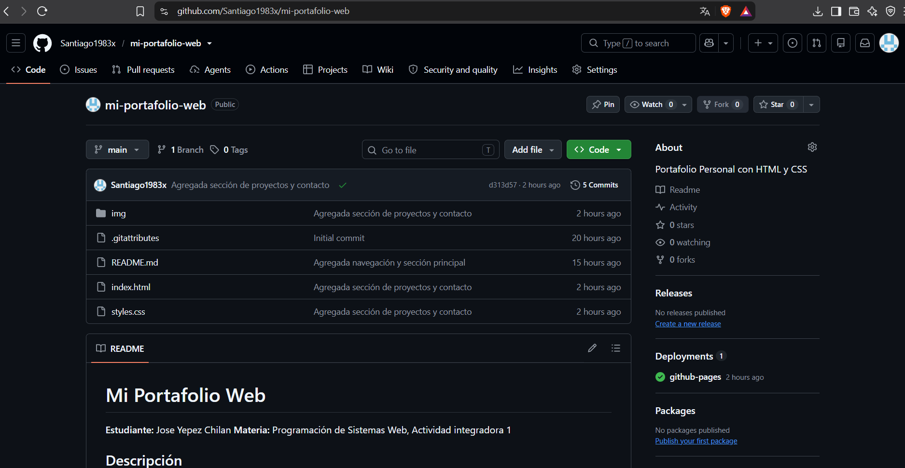

# Mi Portafolio Web

**Estudiante:** Jose Yepez Chilan
**Materia:** Programación de Sistemas Web, Actividad integradora 1

## Descripción
Sitio web que funciona como portafolio personal, con mis datos,
habilidades, proyectos y un formulario de contacto.

## Tecnologías utilizadas
- HTML5
- CSS3
- Git y GitHub

## Cómo visualizar el proyecto
Abrir el archivo `index.html` en el navegador.

Sitio publicado:https://santiago1983x.github.io/mi-portafolio-web/

## Estructura
```
mi-portafolio-web/
 |--- index.html
 |--- styles.css
 |--- README.md
 |--- img/
        |--- Perfil.jpeg
        |--- proyecto1.jpg.jpg
        |--- Proyecto2.jpeg
        |--- PORTAFOLIO.png
```

## Imágen (opcional)
